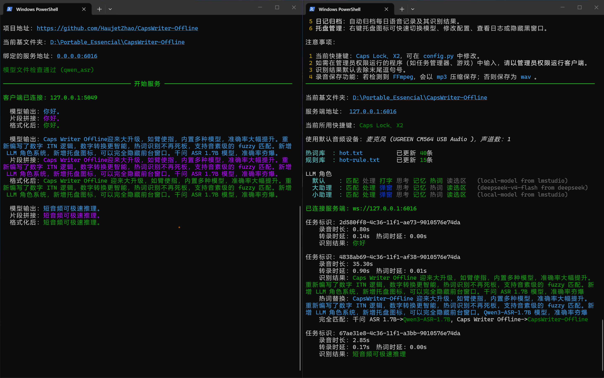
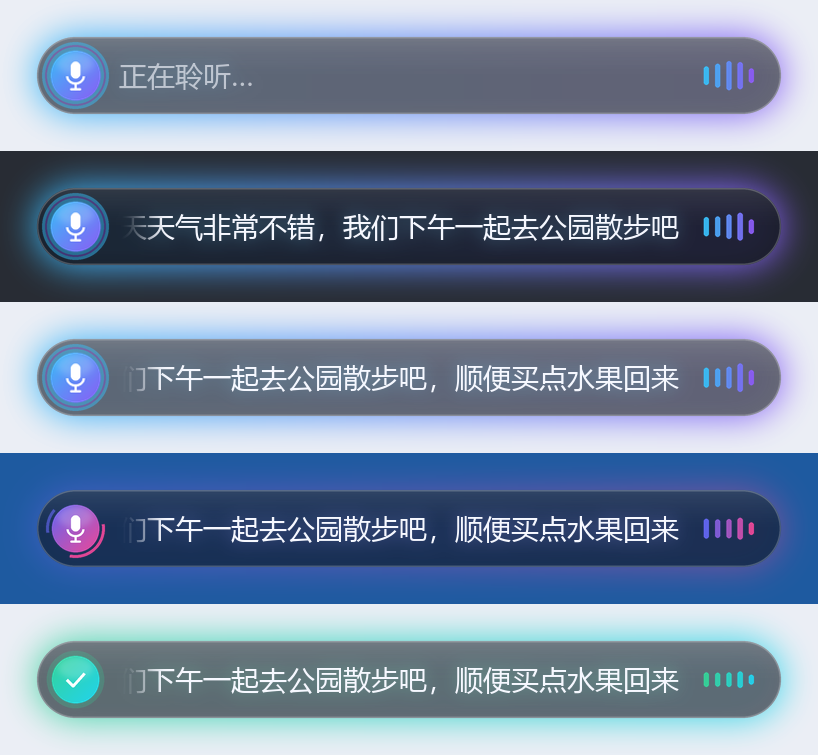
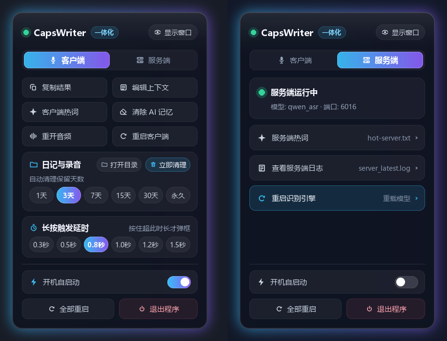

# CapsWriter-Offline-Plus (v1.0)

> 基于开源项目 [HaujetZhao/CapsWriter-Offline](https://github.com/HaujetZhao/CapsWriter-Offline)（MIT 协议）深度定制的个人增强版。  
> 保留原版完全离线、低延迟、高准确率引擎与全套模型支持，针对单机个人日常使用重做了**一体化启动、毛玻璃流式语音悬浮窗、现代托盘控制面板与自动清理**。

> **按住 CapsLock 说话，悬浮窗实时打字，松开瞬间上屏。就这么简单。**

---

## 🚀 定制增强版核心升级

### 1. 一体化单 EXE 启动（`CapsWriter.exe`）
- **双击即用**：新增 `CapsWriter.exe`（基于统一客户端/服务端架构），双击单个程序自动在后台同时拉起本地语音识别服务端与客户端，无需再分别启动两个程序。
- **单托盘常驻**：任务栏只保留一个一体化托盘图标，控制台窗口自动最小化隐藏；仍兼容原版分离模式（`start_server.exe` / `start_client.exe`）。

### 2. 深色毛玻璃流式语音悬浮条
- **0.6 秒极速流式响应 + 无缝拼接**：语音识别实时预览间隔缩短至 0.6 秒，并对滑动窗口结果进行智能尾部对齐合并，彻底解决一段一段跳字的问题。
- **逐字打字与滚动字幕**：新识别的文字逐字淡入上浮打出，始终平滑滚动展示最新 20 个字；顶部带有发光胶囊渐变光晕与实时麦克风声波柱，说话音量实时驱动波纹与光晕呼吸。
- **松开瞬间上屏**：默认启用剪贴板一次性粘贴上屏（并自动恢复原有剪贴板内容），长篇语音（500～1000 字）也能毫秒级完成上屏。

### 3. 现代深色毛玻璃托盘控制面板
- **0 级嵌套单卡收纳**：基于纯 Win32 分层窗口 (`UpdateLayeredWindow`) + Pillow 绘制，右键托盘图标在屏幕工作区边缘弹出半透明毛玻璃圆角卡片，彻底告别传统右键菜单多层向右展开、贴边往左折叠遮挡的问题。
- **客户端 / 服务端分页切换**：面板内直接平滑切换「客户端」与「服务端」视图，支持独立重启服务端识别引擎或热重载客户端组件。
- **开机自启动一键开关**：底部集成 Windows 注册表（`HKCU\...\Run`）开机自启滑动开关，所有托盘操作提示统一接入底部毛玻璃胶囊悬浮通知。

### 4. 录音与日记自动彻底清理
- **自动回收磁盘空间**：默认保留最近 **3 天**的语音日记（`.md`）与录音文件（`assets/*.mp3` / `.wav`），过期文件会直接从磁盘永久删除（不经过回收站）并自动清除空目录。
- **托盘面板一键调节**：无需翻找配置文件，在托盘面板的「日记与录音」卡片中即可点击切换 `1天 / 3天 / 7天 / 15天 / 30天 / 永久`，或一键打开当月目录 / 立即清理。

---

## ✨ 基础核心特性（继承自原版）

- **语音输入**：按住 `CapsLock键` 或 `鼠标侧键X2` 说话，松开即输入，默认去除末尾逗句号。支持对讲机模式和单击录音模式。
- **文件转录**：音视频文件往 `start_client.exe`（或 `CapsWriter.exe`）一丢，字幕 (`.srt`)、文本 (`.txt`)、时间戳 (`.json`) 统统都有。
- **数字 ITN**：自动将「十五六个」转为「15~16个」，支持各种复杂数字格式。
- **热词替换**：在 `hot.txt` 记下偏僻词，通过音素模糊匹配，相似度大于阈值则强制替换。
- **正则替换**：在 `hot-rule.txt` 用正则或简单等号规则，精准强制替换。
- **LLM 角色**：预置了润色、大助理、小助理、翻译等角色，当识别结果的开头匹配任一角色名字时，将交由该角色处理。
- **日记归档 & 录音保存**：按 `年/月` 自动保存每日语音及其本地音频文件。

以下为支持的模型：

| 引擎名 | 准确性 | 速度 | 格式 | 显卡加速 |
|------|-------|------|------|---------|
| Paraformer | ★★★☆☆ | ★★★★★ | ONNX | ❌ |
| SenseVoice-Small | ★★★☆☆ | ★★★★★ | ONNX | ✅ |
| Fun-ASR-Nano | ★★★★☆ | ★★★★☆ | ONNX + GGUF | ✅ |
| Qwen3-ASR | ★★★★★ | ★★★☆☆ | ONNX + GGUF | ✅ |

性能参考（20s 音频转录延迟）：

| 模型 | CPU U9-285H | GPU RTX5050 |
|------|------------|------------|
| Paraformer | 0.6s | - |
| SenseVoice-Small | 0.6s | 0.15s |
| Fun-ASR-Nano | 2.0s | 0.5s |
| Qwen3-ASR-1.7B | 4.0s | 1.0s |

详细功能说明请参考 [`docs/`](docs/) 目录：
- [环境依赖安装说明](docs/环境依赖安装说明.md) — VC++ 运行库、FFmpeg 安装
- [热词功能如何使用](docs/热词功能如何使用.md) — 热词替换、规则替换、自定义短语
- [角色功能如何使用](docs/角色功能如何使用.md) — LLM 角色配置、输出模式、创建新角色
- [识别语言如何配置](docs/识别语言如何配置.md) — 各引擎语言支持范围与配置方法
- [文件转录功能如何使用](docs/文件转录功能如何使用.md) — 拖拽转字幕、时间戳对齐
- [显卡加速的若干问题](docs/显卡加速的若干问题.md) — DirectML、Vulkan 加速配置
- [模型下载的若干问题](docs/模型下载的若干问题.md) — 引擎选择、模型下载、目录结构
- [常见问题](docs/常见问题.md) — FAQ
- [更新日志](docs/CHANGELOG.md)

---

## 💻 平台支持

目前**仅能保证在 Windows 10/11 (64位) 下完美运行**。

- **Linux**：暂无环境进行测试和打包，无法保证兼容性。
- **MacOS**：由于底层的 `keyboard` 库已放弃支持 MacOS，且系统限制极多，暂时无法支持。

---

## 🎬 快速开始

1. **准备环境**：确保安装了 [VC++ 运行库](https://learn.microsoft.com/zh-cn/cpp/windows/latest-supported-vc-redist)。若需要以 MP3 格式保存录音或使用文件转录功能，建议安装 [ffmpeg](https://ffmpeg.org/download.html) 并确保其在系统 PATH 中。
2. **下载程序与模型**：
   - 从本仓库的 **Releases** 页面下载绿色运行包 `CapsWriter-Offline-Plus-v1.0.zip` 并解压；
   - 下载语音模型压缩包（如 `Qwen3-ASR-1.7B-q5_k.zip`），请前往本仓库 [Models Release](https://github.com/chardlink/CapsWriter-Offline-Plus/releases/tag/models) 下载全套独立备份模型（原项目镜像：[HaujetZhao/CapsWriter-Offline](https://github.com/HaujetZhao/CapsWriter-Offline/releases/tag/models)），解压放入 `models/` 下对应引擎目录中（如 `models/Qwen3-ASR/Qwen3-ASR-1.7B/`）。
3. **一键启动**：直接双击根目录的 **`CapsWriter.exe`**，程序会自动拉起内置服务端并最小化到右下角托盘图标。
4. **开始语音输入**：按住 **`CapsLock`** 键或 **`鼠标侧键 X2`** 说话即可实时看到悬浮窗字幕，松开按键自动瞬间粘贴上屏！
5. **（可选）分体模式 / 源码运行**：
   - 如需跨机部署服务端/客户端，仍可分别运行 `start_server.exe` 与 `start_client.exe`；
   - 如直接拉取源码运行，安装依赖后执行 `python start_client.py`（一体化/客户端）或 `python start_server.py`（独立服务端）。

---

## ⚙️ 个性化配置

所有的设置都在根目录的 [`config_server.py`](config_server.py) 和 [`config_client.py`](config_client.py) 里，可直接编辑，常用项也可直接右键托盘图标在悬浮控制面板中即时修改。

---

## 🛠️ 常见问题

**Q: 为什么按了快捷键没反应？**  
A: 请确认 `CapsWriter.exe` 已正常运行在系统托盘中。若想在管理员权限运行的程序（如任务管理器、部分游戏）中输入，请右键以管理员权限运行 `CapsWriter.exe`。

**Q: 如何设置开机自启动？**  
A: 右键点击右下角托盘图标，直接在毛玻璃控制面板底部开启 **「开机自启动」** 滑动开关即可，无需手动折腾 `shell:startup`。

**Q: 录音文件会越来越占硬盘吗？**  
A: 本定制版默认只保留最近 **3 天** 的录音与语音日记，超过天数会自动从磁盘彻底删除；可在托盘控制面板的「日记与录音」卡片中自由切换为 `1天 / 3天 / 7天 / 15天 / 30天 / 永久`。

更多基础问题请参阅 [docs/常见问题.md](docs/常见问题.md)。

---

## ❤️ 致谢

- 感谢原作者 [HaujetZhao](https://github.com/HaujetZhao) 开源了优秀的 [CapsWriter-Offline](https://github.com/HaujetZhao/CapsWriter-Offline) 项目（MIT License）。
- 本项目底层识别引擎基于 [Sherpa-ONNX](https://github.com/k2-fsa/sherpa-onnx)、[FunASR](https://github.com/alibaba-damo-academy/FunASR) 与 [Qwen3-ASR](https://github.com/QwenLM/Qwen3-ASR) / llama.cpp。
